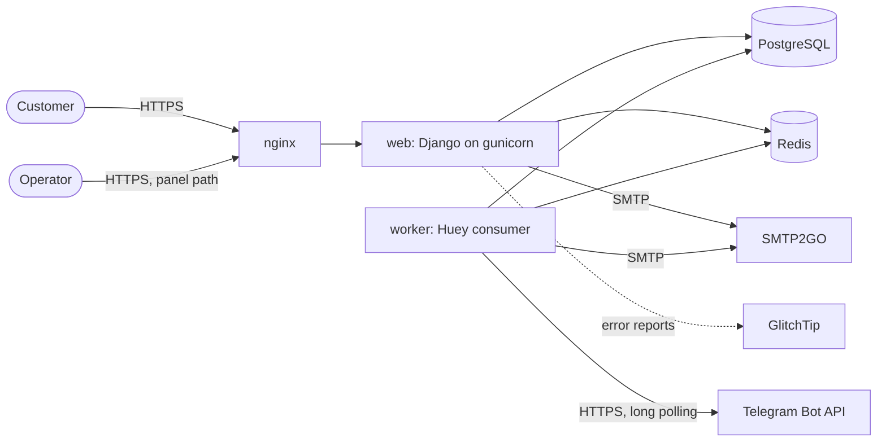

# Architecture

PremShop is a Django modular monolith that renders Persian, right-to-left pages on the server. One codebase runs as two processes, a web server and a background worker, against PostgreSQL and Redis. This document describes how the built system is organised and the rules that hold it together.

Related documents: the [data model](data-model.md) for tables and constraints, the [order lifecycle](order-lifecycle.md) for statuses and locking, and the [decision records](decisions/README.md) for why each choice was made.

- [System context](#system-context)
- [Applications and boundaries](#applications-and-boundaries)
- [Inside an application](#inside-an-application)
- [Single entry points](#single-entry-points)
- [Request flows](#request-flows)
- [Background jobs](#background-jobs)
- [Email](#email)
- [Security](#security)
- [Cross-cutting conventions](#cross-cutting-conventions)
- [Not built yet](#not-built-yet)

## System context



| Component | Role |
|---|---|
| nginx | Terminates TLS, serves the hashed static files, forwards everything else to `web`, and answers with a maintenance page while `web` is down. It sets `X-Real-IP`, the only client address the application trusts. |
| web | Django under gunicorn as a non-root user: the storefront, the customer pages and the operator panel. |
| worker | One Huey consumer (`manage.py run_huey`), two threads, for the [scheduled jobs](#background-jobs), including the Telegram bot's poll. |
| PostgreSQL | The system of record. Row locks and CHECK constraints are part of the design, so development and tests run on PostgreSQL as well. |
| Redis | Django's cache: sign-in codes, rate-limit counters and Huey's queue. Nobody can sign in while it is down. |
| SMTP2GO | The relay for every outgoing email ([ADR-0022](decisions/0022-transactional-email.md)). |
| GlitchTip | Error reports through `sentry-sdk` when `SENTRY_DSN` is set ([ADR-0015](decisions/0015-error-tracking-glitchtip.md)). |

Production runs one Docker image per commit, with `web` and `worker` from the same image beside PostgreSQL 15, Redis 7 and nginx (`deploy/compose.yaml`). Building and checking the image is described in [development](development.md#production-image); deploying it in the [runbooks](runbooks/deploy.md).

## Applications and boundaries

Every application lives under `apps/`. An application may import only from the applications to its left:

```text
core  →  accounts, catalog, cms  →  cart, orders  →  payments  →  notifications
```

| App | Owns |
|---|---|
| `core` | Shared infrastructure: the encrypted field, email sending and mail accounting, the rate limiter, Persian formatting filters, the restricted Markdown renderer, support details, middleware, error pages, the health check and the panel's admin site. |
| `accounts` | The `User` model, sign-in by code, and the account page. |
| `catalog` | Categories, products, plans, page sections and questions; the price function, search, the publishing rule, the storefront pages, SEO and the catalogue editor in the panel. |
| `cms` | Five legal and information pages, with drafts and staff previews ([ADR-0030](decisions/0030-legal-page-drafts.md)). |
| `cart` | Persistent guest and account carts, the merge at sign-in and the guest-cart purge. |
| `orders` | Orders, items, their history, discount codes and redemptions: placement, cancellation and expiry, the customer order pages, public tracking, the invoice, the staff reveal of customer input, and the operator's delivery of account details. |
| `payments` | Checkout, payment/refund records, operator-only manual confirmation and recording completed refund transfers through the order editor, and daily reconciliation. The gateway is not built yet. |
| `notifications` | Purchase confirmations and order updates through a durable outbox, by email and, for a customer who linked Telegram, by Telegram too. |

Two rules keep the graph honest:

- **`cart` and `orders` are siblings.** Neither imports the other, so `orders` does not know how a cart is stored: `orders.services.place_order` takes plain `OrderLine` values, and `payments.checkout` is the one place the two meet ([ADR-0018](decisions/0018-shopping-cart-and-guest-checkout.md)).
- **One exception is allowed.** The account page in `accounts` reads `orders.selectors` to show the customer's current order.

The import rule and the service layer are [ADR-0002](decisions/0002-module-boundaries-and-service-layer.md).

## Inside an application

| Module | Holds |
|---|---|
| `models.py` | Tables, constraints and model-level validation. |
| `services.py` | Every write. Each operation is one transaction that locks what it changes, and a status change writes its history row in that same transaction. In `orders` and `payments`, arguments are keyword-only. |
| `selectors.py` | In `orders`: the reads that customer pages render from, with ownership already applied. |
| `views.py` | Thin views (below). |
| `forms.py`, `admin.py`, `tasks.py`, `templatetags/` | Input validation, the panel, scheduled jobs and template filters. |

A view does five things and nothing else:

1. Checks access, fetching any object through a query that already scopes ownership, such as `orders.selectors.customer_orders(user)` or `cart.services.get_cart(request)`, never `Order.objects.get(pk=...)`.
2. Validates input with a Django form. A form checks format only; business rules live in the service, whose `ValidationError` is shown on the same form.
3. Calls at most one service that writes. A GET only reads.
4. Renders a template or redirects.
5. Sets the response headers the page needs, such as `Cache-Control: private, no-store`.

Customer forms carry plan ids, quantities and a discount code; every charge is computed on the server. The operator enters a received amount as evidence, which the server must match to the saved order total. Domain exceptions carry the Persian sentence the customer sees, because the message is part of the behaviour (for example `RateLimited` in `apps/accounts/services.py`).

## Single entry points

Each of these concerns has exactly one path through the code. A second path is a defect, and several are enforced by tests.

| Concern | The one path |
|---|---|
| A price shown or charged | `catalog.pricing.effective_price` ([ADR-0021](decisions/0021-promotional-pricing.md)) |
| Products for sale | `Product.objects.public()`; pages, including unavailable ones that still meet the publishing rule, use `public_pages()` |
| Whether a product may go live | `Product.publish_problems()` ([ADR-0028](decisions/0028-product-page-content-model.md)) |
| Search text, on both sides of the comparison | `catalog.search.normalize_for_search` ([ADR-0025](decisions/0025-catalog-implementation.md)) |
| Sending an email | `core.email.send_templated_email` ([ADR-0023](decisions/0023-email-templates.md)) |
| Operator text to HTML | `core.richtext.render_markdown` ([ADR-0027](decisions/0027-operator-text-restricted-markdown.md)) |
| Persian digits, toman and Jalali dates | `core.formatting`, exposed as filters by `` |
| A money column | `MoneyField()` in `apps/catalog/models.py`: whole toman, exact decimal |
| Where a customer reaches a person | `core.support.details()`, given to every template and email as `support` |
| A promise printed on every page | `apps/catalog/promises.py`, each promise beside the condition every public product must meet |

## Request flows

### Browsing and search

| Path | Page |
|---|---|
| `/` | Home: the shop's range, category shelves and current offers |
| `/c/<slug>/` | A category |
| `/p/<slug>/` | A product |
| `/search/`, `/search/suggest/` | Search results and suggestions |
| `/faq/` | Frequently asked questions |
| `/<slug>/` | A published legal or information page |

A product page is assembled from the content model ([ADR-0028](decisions/0028-product-page-content-model.md)): facts the shop commits to live in fields, prose lives in ordered sections of six kinds (each drawn by `templates/catalog/sections/<kind>.html`), and questions are their own rows. A draft is a 404, except for staff with `catalog.view_product`, who see it as a preview marked `noindex` and `no-store`.

Search folds the query and each product's stored `search_text` through the same normaliser, which handles Arabic-keyboard letters, half-spaces and Persian digits. An exact pass runs first, then a trigram word-similarity fallback at 0.45. A search that finds nothing lists the catalogue, so a misspelt name still leads to the product.

Every storefront page has a tested query budget: six queries on the home page, five on a category page and nine on a product page with related products. `config/seo.py` serves the sitemap and `robots.txt`.

### Sign-in

`/login/` is one flow for signing in and registering, by a six-digit code sent by email ([ADR-0024](decisions/0024-auth-implementation.md)). Each account has one way in: a customer signs in by code and has no password, and staff sign in only at the panel, with a password. A right code for a staff account gets the wrong-code answer, because a staff session opens the panel.

- **Codes** are stored hashed in Redis for ten minutes, with their deadline beside them. Each guess increments an attempt counter before the code is compared, and the code is spent by the one delete that removes it, so two requests carrying the right code cannot both sign in.
- **Rate limits** apply per email and per IP address on every sign-in endpoint. The panel's sign-in draws on the same budgets, so an address has one budget wherever it is guessed at. Accepted code emails also have a daily budget.
- **Redis failure** turns into a Persian 503 page. Sign-in never fails open, because that would allow unlimited guesses at a six-digit code.

Signing in rotates the session and merges the visitor's guest cart into the account's (`cart.signals`, on `user_logged_in`), so every sign-in path gets the merge without asking for it.

### Cart

`/cart/` shows the cart; adding, changing a quantity and removing are CSRF-protected POSTs that work without JavaScript, and with JavaScript update the header count and a toast in place.

- A visitor's cart is filed under their session key for 30 days; a signed-in customer's cart belongs to the account on every device. The merge at sign-in caps each line at the plan's limit and tells the customer when a quantity was reduced.
- A cart line stores the plan and the quantity only. Prices are recomputed on every render, and nothing is reserved: an unavailable line stays visible, contributes no amount and blocks checkout until it is removed.
- `/cart/availability/` refreshes the state of up to fifty plans and is never cached.

### Checkout and order placement

`/checkout/` shows a review computed on the server. A visitor who is not signed in does so inline, through the same code endpoints, and the page reloads with the merged cart.

1. **The quote.** The review issues a signed quote, valid for 15 minutes, binding the account, the cart's revision and items, a digest of the purchase terms, the discount code and the customer-input declarations. Amounts displayed in the browser have no authority.
2. **The submission.** `payments.checkout` locks the account, then the cart, and calls `orders.services.place_order`. In one transaction it re-reads every price through `effective_price`, claims finite stock, applies and records the discount code, freezes what was bought, writes one history row per unit and deletes the cart's lines. Any failure rolls back everything and leaves the cart as it was.
3. **Replays.** Each submission carries a unique checkout id and a keyed digest of what was submitted. A repeated submit returns the order it already created; another account or a changed submission cannot reuse the id.
4. **The result.** The order starts as `PENDING_PAYMENT` with a fixed 24-hour deadline, and a customer has at most one live unpaid order. An operator can record a matching payment and queue its items. An order left unpaid expires and releases its stock and discount ([order lifecycle](order-lifecycle.md)).

### Customer pages

| Path | Page |
|---|---|
| `/account/` | Profile and the current order |
| `/account/orders/` | The customer's orders in four groups, by the state each order leads with, 20 per page |
| `/account/orders/<number>/` | One order: what was bought, its status and history, the saved terms |
| `/account/orders/<number>/cancel/` | Cancelling an unpaid order (a confirmed POST) |
| `/account/orders/<number>/invoice/` | A standalone HTML invoice; the PNG export is drawn in the browser |
| `/track/<token>/` | Public tracking for whoever holds the link |

Ownership is part of every customer query in SQL, staff included. The tracking page has its own per-IP and per-token rate limits, sends `no-store`, `noindex` and `no-referrer`, and shows only the product name, the status and its times. Tracking links are redacted from application logs and error reports; the proxy in front must redact them from its own access log.

### Operator panel

The panel is the Django admin with django-unfold. In production it is served at `ADMIN_PATH` and `/admin/` is a 404; development and tests serve it at `/admin/`. It is Persian and right to left, with an English switch that applies inside the panel only.

- **Home:** the catalogue at a glance: published products, active offers, sold-out plans, offers ending within 48 hours and drafts (`apps/catalog/dashboard.py`).
- **Catalogue:** products, plans, specifications, sections and questions. Publishing goes through `Product.publish_problems()`, and a draft's form lists every reason it cannot yet go live. An unsaved preview renders the edited product through the storefront's own code without writing a row.
- **Discount codes:** created and deactivated here. The panel deletes none, because a used code is part of how an order's total was computed.
- **Orders:** an order's saved purchase facts are read-only. Revealing an item's customer input goes through `orders.services.reveal_customer_input`, which checks permissions and logs who looked and when. `payments.admin` adds operator-only payment and completed-refund-transfer forms and their histories. They call `record_manual_payment` and `execute_refunds`; views write no status themselves. A read-only daily reconciliation page separates money received, refunds newly owed and refunds sent, with non-blocking warnings for shared bank references.
- **Pages:** the legal pages, previewed as drafts and published by a separate permission.
- **Notifications and mail attempts:** read-only lists of what was sent, what is waiting and what failed.

The catalogue's database constraints carry Persian error messages, each shown under the field it is about, so the operator sees the database's own rule where it can be corrected. Discount codes and pages give their Persian errors from form and model validation, before the database is reached.

## Background jobs

One Huey consumer runs these, scheduled in UTC:

| Task | Schedule | Does |
|---|---|---|
| `notifications.tasks.send_order_notifications` | every minute, and at once when an update is queued | Finds new purchase confirmations and sends due order emails and Telegram messages; the minute run is the retry |
| `accounts.tasks.poll_telegram` | without a break; every minute as a restart | Long-polls the shop's Telegram bot for about 55 seconds, answers what arrives, then queues the next poll at once; a lock stops two polls overlapping, and one held three minutes with no poll behind it is logged and cleared; after an outage only the minute run tries again |
| `orders.tasks.sweep_unpaid_orders` | every minute | Releases up to 100 overdue unpaid orders, each in its own transaction, and records the sweep's time and backlog |
| `cart.tasks.clean_guest_carts` | daily 03:00 | Deletes guest carts inactive for more than 30 days |
| `core.tasks.clean_expired_sessions` | daily 03:10 | Removes expired sessions |
| `core.tasks.clean_mail_attempts` | daily 03:15 | Deletes mail-attempt rows older than 90 days |
| `orders.tasks.clean_credential_access_logs` | daily 03:20 | Deletes access-log rows older than 365 days |
| `orders.tasks.clean_delivered_details` | daily 03:25 | Deletes delivered details and customer input past their retention deadline ([Retention](order-lifecycle.md#retention)), each item in its own transaction |

- The queue name is derived from the database's host, port and name, never its credentials, so each database has its own consumer. Huey runs asynchronously in development too; tests use in-memory storage and run tasks explicitly.
- The consumer runs two threads: the Telegram poll keeps one, and the other runs the minute jobs. It flushes task locks as it starts (`flush_locks`). A worker killed mid-poll never releases its lock, and Redis keeps it across the restart.
- A stopped worker delays releases but never corrupts them: checkout still validates stock and deadlines under locks, and a restarted worker catches up from the stored deadlines. The panel's order list warns when the last successful sweep is more than three minutes old. `/healthz` checks the database and the cache, not the worker.

## Email

Every message is three templates under `templates/email/` (`<name>.subject.txt`, `<name>.txt`, `<name>.html`), sent as one multipart message by `core.email.send_templated_email`, so no Persian sentence lives in Python. The HTML uses tables, inline styles and installed system fonts ([ADR-0023](decisions/0023-email-templates.md)). With `DEBUG` on, `/dev/emails/` renders each message from the sample context in `EMAIL_PREVIEWS` (`apps/core/views.py`), and a test fails when a message has no entry there.

| Message | Sent when |
|---|---|
| `otp_code` | A sign-in code is requested |
| `purchase_confirmation` | An order is placed (unpaid at that point, and the message says so) |
| `payment_confirmed` | A payment is verified; once per payment, for the whole order |
| `input_requested` | An item starts waiting for activation details |
| `delivery_completed` | An item is delivered or a replacement is delivered |
| `replacement_rejected` | The operator rejects an open replacement claim |
| `supply_delayed` | The operator moves the delivery deadline; includes the new deadline |
| `item_cancelled` | A paid item is cancelled, its refund described as owed; an unpaid order's cancellation is one message for the whole order |
| `item_refunded` | A refund transfer is recorded |
| `item_delivered` | Reserved template for the planned single-use delivery link; not sent |

**Mail accounting.** `core.MailAttempt` records every recipient submission on its own database connection, with a keyed hash of the address and the outcome, never the address or the message. The rows double as the quota counter against the provider's allowance, with a reserve kept for security messages. `EMAIL_QUOTA_RESET_DATE` and `EMAIL_QUOTA_STARTING_USAGE` align the count with the provider ([ADR-0022](decisions/0022-transactional-email.md)).

**Purchase confirmations.** Every minute the worker finds committed orders that carry a placement email and have no confirmation yet, renders the message and freezes it in a `Notification` row under the unique key `purchase-confirmation:{order_pk}:email`. Sending is attempted six times: at once, then after 1, 5 and 15 minutes, 1 hour and 6 hours. A quota refusal pauses every send for 15 minutes without spending an attempt. An occasional duplicate after an uncertain SMTP result is accepted over a confirmation that never arrives ([ADR-0010](decisions/0010-event-log-and-notification-outbox.md)).

**Order updates.** Explicit service calls register `core.events.emit` callbacks after commit. Each callback freezes an allowlisted message in the same outbox, keyed by template, payment/history occurrence, customer and email channel. Callback failures log IDs and exception classes, never free text, and cannot undo the committed action or stop another callback. Historical events are not replayed. Delivery links open the signed-in order detail; customer credential reveal and magic links remain planned. Purchase confirmations retry every failure; other messages stop at once only when every recipient is refused with a 5xx, and take the same ladder for every other failure, including the account's own login, sender and DATA rejections. All share the durable quota cooldown and the security-mail reserve. The accepted commit-to-enqueue crash gap applies to updates, not purchase-confirmation discovery.

**Telegram.**
- **Linking.** The account page's «اتصال تلگرام» issues a random, single-use ten-minute token. Only the account's newest token counts. The page offers it as a `t.me` link to the shop's bot, plus a `/start` line to send by hand. While it waits, the page asks every two seconds whether the link went through and shows it without a reload. The bot shows the masked email and links only when its confirm button is pressed; spending the token is the cache delete that succeeds. The link and an unlink each email the account holder, and a Telegram linked elsewhere moves, telling its old account by email. A confirmed link offers a button to its settings and opens the panel beneath. Starting in the bot answers an unlinked Telegram with what the bot is for, the three steps of linking and a button to the account page, and opens a linked one's panel: the bot never sends a link that links on click, which a scammer could pass to a victim. Groups and channels link nothing.
- **Screens.** Every bot message opens with its emoji and a bold title, labels its fields with an emoji each, keeps an order's state in a quote and carries its links as buttons, never in the text. A row holds two buttons at most, and a screen at most one coloured button: blue for its main action, green only on the link's confirm button, red never. The emoji live in `core.telegram_emoji`, the one file the repository's emoji check allows.
- **The panel.** A linked customer's `/start`, or anything they type, opens one panel message: a grid of four lists, the site's order groups «در انتظار پرداخت», «در جریان», «تحویل‌شده» and «لغوشده», each button counting its orders, then buttons to the shop (the home's main action), the account page and the support account, and one that shares the shop through Telegram's share sheet. Each order sits in exactly one list, the group of the state it leads with, as the site's order list files it. A list shows its five latest orders, each in its own quote with its products, status and date and on a button marked with its product's emoji, under a button to the site's order list; each opens in the same message with its amount, its next step as the order page words it, buttons that copy its number and open its page, and a button to the support account, its main action, wherever the order page offers support except on an unpaid order, and returns to its list. Presses edit that one message, each before it is answered, so the new screen shows after one round trip to Telegram rather than two; a new panel deletes the old one (or, past Telegram's 48 hours for deleting, removes its buttons), and the customer's own command is deleted; notices are never touched. Every press looks up the account linked to the presser again, and an order shows only when it is theirs (`orders.telegram_panel`, registered with the bot as the orders app starts, since accounts may not import orders). Every line opens with a Persian label, since Telegram sets a line's direction from its first letter. Presses and messages share a limit of 60 a minute per Telegram account, and a press is carried out even when Telegram refuses a late answer to it. The panel carries no credential, input or way to pay: Telegram requires its Stars for goods sold inside a bot, so paying stays on the site. The bot lists `/start` in its command menu once a day.
- **Receiving.** The worker long-polls the Bot API without a break, since Telegram cannot call a server inside Iran or one with no public address. Each worker thread keeps one HTTPS connection open, through the system's proxy when one is set, because through a VPN or the relay a new one costs most of a second. A connection outage logs one ERROR, then WARNINGs until it recovers.
- **Sending.** Before each Telegram send, the sender locks the customer's row and drops the row as `binding_changed` unless the customer is still linked to the frozen chat. Unlinking waits for an in-flight send, which times out after five seconds. A 429 waits Telegram's `retry_after`; 400 and 403 fail at once; every other failure takes the six-attempt ladder. The mail quota wait holds email rows only. A notice opens with its product's emoji, and its order's page is a coloured button built from the row's order as it is sent.
- **The token.** It is in every Bot API URL, so the client re-raises failures without the URL, and `redact_url` removes bot tokens from logs and error reports, breadcrumbs included. A blank `TELEGRAM_BOT_TOKEN` switches all of this off.

No message carries a credential value or a customer's input ([ADR-0008](decisions/0008-content-free-messages-and-magic-link.md)).

## Security

| Concern | How it is handled |
|---|---|
| Authorization | Checked on the server for every object. Customer queries filter by owner in SQL; staff actions check model permissions; tracking needs an unguessable token. |
| Rate limiting | Per identity and per IP on every sign-in endpoint, the panel's included; also on search and tracking. Fails closed when Redis is down. |
| Client address | In production, read from `X-Real-IP`, which nginx overwrites, never from `X-Forwarded-For`, which a visitor can write. |
| Stored secrets | `OrderItem.customer_input` is encrypted with Fernet. Retired keys stay readable through `FIELD_ENCRYPTION_KEY_FALLBACKS` until `manage.py reencrypt_fields` has rotated every row. The key is escrowed offline, and a restore that cannot decrypt is a failed restore ([ADR-0007](decisions/0007-credential-encryption-key-escrow-retention.md)). |
| Revealing a secret | Through one service, which logs the staff member, the time and the address. The order history never decrypts. |
| Messages and logs | No credential value in any message, log or error report. Tracking links are redacted from logs and from error-report URLs. |
| HTML output | Three bounded entry points may mark a string safe: `render_markdown`, the constant zero-price markup in `fa.py`, and `json_ld`. `apps/core/tests/test_safe_markup.py` refuses any other. Operator Markdown is rendered with raw HTML off, then cleaned by an allowlist. |
| Uploads | `ReencodedImageField` decodes an image with Pillow, checks its size and pixel count, and stores a redrawn copy under a random name. The uploaded bytes are never stored. |
| Malformed input | `RejectNul` answers a NUL byte in the path or query with a 404 before anything queries the database. |
| Configuration | `config/settings/prod.py` refuses to start without allowed hosts, SMTP credentials, a From address on the shop's domain, an https `SITE_URL`, and valid, distinct encryption keys. |
| Dependencies | CI runs `pip-audit` and `bandit` on every push. |

## Cross-cutting conventions

- **Settings** are `config/settings/{base,dev,prod}.py`, driven by the environment. `.env` is loaded with `setdefault`, so the real environment always wins; `manage.py` and pytest default to `dev`, and `wsgi`/`asgi` to `prod`. `.env.example` documents every variable, and a test fails when one is missing.
- **Absolute addresses** are built on `SITE_URL`, never on the request's `Host` header: the canonical link, `og:url`, `og:image` and the links in emails.
- **Page titles.** A template's title block holds its own part only; `base.html` appends « | PremShop» once, through the `shop_title` filter.
- **Templates.** A Django `{# #}` comment is single-line only, so multi-line notes use `` (a test scans every template). A template that uses the Persian filters must ``. A page that must not be indexed fills the `meta_robots` block.
- **Styles** are component classes built from tokens, not utilities in markup. Tailwind v4 scans `templates/` only. The tokens and visual rules are in the [design language](design-language.md).
- **Language.** Customer-facing text is Persian; code, comments and logs are English. A Latin name inside Persian text is isolated: `<bdi>` in a template, U+2068 and U+2069 in a Python string.
- **Panel translations.** Panel strings are written in Persian and wrapped in `gettext_lazy`. `locale/en/` holds their English for the panel's language switch, and `locale/fa/` rewords Django's and Unfold's own strings. `PersianUnlessChosen` keeps the shop itself Persian.
- **Error pages** are the shop's own. The 500 page renders without context processors, because the database may be what failed; a CSRF failure from the panel leads back to the panel.

## Not built yet

The following are designed and bound by decisions, but not implemented:

| Capability | Decisions |
|---|---|
| Payment through the gateway: server-side verification, amount check, idempotent confirmation, lost-callback inquiry, refunds | [ADR-0019](decisions/0019-payment-gateway.md), [ADR-0013](decisions/0013-payment-provider-interface-deferred.md), [ADR-0005](decisions/0005-money-in-toman.md) |
| The customer's view of delivered details and the single-use delivery link | [ADR-0007](decisions/0007-credential-encryption-key-escrow-retention.md), [ADR-0008](decisions/0008-content-free-messages-and-magic-link.md) |
| The reminders and timeout for missing customer input | [ADR-0009](decisions/0009-sla-clock-and-input-timeout-ladder.md) |
| Operator alerts, sign-in codes over Telegram and the remaining customer messages | [ADR-0010](decisions/0010-event-log-and-notification-outbox.md), [ADR-0012](decisions/0012-auth-email-otp.md) |
| The order dashboard | [ADR-0002](decisions/0002-module-boundaries-and-service-layer.md) |
| An HTTP API | [ADR-0004](decisions/0004-no-drf-in-phase-1.md) |

What is deliberately never built, each with the condition that would change that, is [ADR-0014](decisions/0014-deliberate-simplifications.md).
