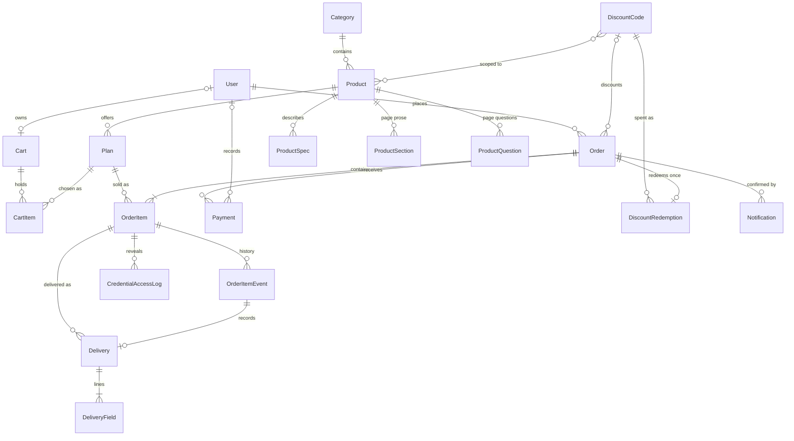

# Data model

The tables that exist today, the rules the database enforces, and the reasons behind the rules that the code cannot state. Each app's `models.py` and migrations are the source of truth for column details; this document is the map.

- [Conventions](#conventions)
- [1. Entity-relationship diagram](#1-entity-relationship-diagram)
- [2. Tables by app](#2-tables-by-app)
- [3. Constraints](#3-constraints)
- [4. Deletion rules](#4-deletion-rules)
- [5. Indexes](#5-indexes)
- [6. Deliberately not modelled](#6-deliberately-not-modelled)
- [7. Planned tables](#7-planned-tables)

## Conventions

- **Money** is whole toman in `DecimalField(max_digits=12, decimal_places=0)`, defined once as `MoneyField()` in `apps/catalog/models.py`. Rial will exist only at the payment gateway's boundary ([ADR-0005](decisions/0005-money-in-toman.md)).
- **Time** is stored in UTC. Jalali dates are a display concern of `core.formatting`.
- **Encrypted columns** (`EncryptedTextField`) hold Fernet ciphertext ([ADR-0007](decisions/0007-credential-encryption-key-escrow-retention.md)).
- **Snapshots.** An order freezes what was bought, at what price and under which published terms. Later catalogue edits never change a placed order.
- **Constraint names** below are the names in the database, so an error can be traced to its rule.

## 1. Entity-relationship diagram

Not drawn, for readability: the user keys on `DiscountRedemption`, `OrderItemEvent` and `CredentialAccessLog`. Standalone tables: `cms.Page`, `core.MailAttempt`, and two single-row status tables, `orders.UnpaidExpirySweep` and `notifications.ConfirmationSweep`.

## 2. Tables by app

### accounts

**User** is a custom model with the email address as the username ([ADR-0024](decisions/0024-auth-implementation.md)).

- **It is frozen as the project's first migration** (`accounts/0001`). Once other tables hold keys to it, replacing the model means rebuilding the schema by hand on live data, so identity fields arrive as additive migrations.
- **Email is unique case-insensitively, in the database** (`user_email_case_insensitive_unique` on `Lower(email)`), not only in the manager, because the panel, a shell or a data import can reach the table without the manager.
- An account created by a sign-in code has an unusable password until the customer sets one.
- `is_staff` is the operator. There are no roles beyond it.
- `phone` is optional. `telegram_id`, `telegram_username` and `telegram_linked_at` are reserved for the Telegram link, which is not built yet.
- Sign-in codes live in Redis with an expiry, not in a table.

### catalog

**Category** is flat, with no parent. Its `slug` is Latin and required, since category names are Persian. `intro` is restricted Markdown; `intro_html` is retired and kept only so its migration can be reversed.

**Product** is a catalogue entry and every fact its page prints.

| Field | Notes |
|---|---|
| `category` | PROTECT: a category with products cannot be deleted |
| `name`, `slug` | A new or changed slug must be Latin, because a Persian slug becomes `%D8%A7…` wherever an address is pasted. A Latin name fills its own slug. Older Persian slugs stay valid until changed, since links already point at them. A slug is editable only while the product is a draft |
| `status` | `draft`, `active` or `unavailable` |
| `short_description`, `usage_notes`, `refund_note`, `warranty` | Commitments the page prints from these fields only. `refund_note` is a per-product exception to the shop's refund rule |
| `delivery_type`, `delivery_hours`, `delivery_note` | `delivery_hours` is between 1 and 48 |
| `delivery_template` | A free-text note for the operator, shown word for word beside the delivery form; nothing parses it or sends it to the customer |
| `aliases` | Spellings customers type, such as «چت جیپت» for ChatGPT. Search input only, never rendered |
| `search_text` | Derived on save from the name, short description, aliases and category name; trigram-indexed |
| `brand_colour` | Optional `#rrggbb` for the card artwork |
| `renewable` | Printed only when true. The default is false, because renewal depends on the provider |
| `sources`, `facts_checked_on`, `time_sensitive` | Where the facts came from and when they were last checked. `sources` is never printed |
| `image` | Stored only as a re-encoded copy (`ReencodedImageField`) |
| `full_description` | Retired: its content moved into sections. Kept for reversibility |

- **Publishing is one rule, `Product.publish_problems()`:** a delivery type, an available plan, the summary and usage notes, at least one Persian search alias, no owner placeholder in any printed text, and, for a time-sensitive product, facts checked within seven days. The schema does not enforce it; every way of publishing calls it.
- **`search_text` stays current** through product saves and through category renames in the same transaction. A bulk `QuerySet.update()` bypasses both and must refresh it explicitly.
- **A product with sales cannot be deleted.** Plans cascade from their product, but the cascade stops at `OrderItem.plan`, which is PROTECT. A sold plan is retired with `is_available = false`.

**Plan** is one purchasable option of a product.

| Field | Notes |
|---|---|
| `cost_price`, `sale_price` | Not negative |
| `promo_price`, `promo_starts_at`, `promo_ends_at` | An optional promotion, cheaper than the sale price, whose window starts before it ends. `effective_price` decides which price applies at a given moment ([ADR-0021](decisions/0021-promotional-pricing.md)) |
| `duration_days` | Null means no fixed period |
| `stock_quantity` | Null means unlimited; otherwise the units available. A cart does not reserve stock; placing an order claims it |
| `is_available` | Retires a plan without deleting it |
| `max_quantity` | 1 to 10. At 1 the product page shows no quantity control |
| `input_type`, `telegram_required`, `requires_customer_input`, `customer_input_label` | What the customer must supply: `unreviewed`, `none`, `email` or `username`. Checkout refuses an unreviewed or inconsistent declaration, and a plan that needs input sells one unit per line |
| `price_confirmed_at` | Set whenever a price changes or the operator confirms prices; a product page prints the oldest among its plans |
| `supplier_url` | The operator's upstream listing. Never copied into an order |

**ProductSpec** holds free rows of facts (`title`, `value`). `is_key` also prints a fact beside the product's title. Region, sharing and device count live here rather than as columns, because a column that is blank on most rows is one the form asks about anyway.

**ProductSection** is the page's prose, in one of six kinds: `benefits`, `includes`, `comparison`, `after_payment`, `before_buying` and `free`. The kind chooses the template. The body is restricted Markdown, a product has at most one `before_buying` section, and an image needs its alternative text ([ADR-0028](decisions/0028-product-page-content-model.md)).

**ProductQuestion** holds a product's questions and their Markdown answers.

### cms

**Page** is one of five fixed legal and information pages, with a title, a Markdown body, a description and a published flag. A published page cannot be empty. Orders keep their own copy of the published terms, so pages need no revision history ([ADR-0030](decisions/0030-legal-page-drafts.md)).

### cart

**Cart** belongs to exactly one owner: an account (`user`) or a visitor's session (`session_key`), each unique when set. It is deleted with its account.

**CartItem** is a plan and a quantity, nothing else: no price, name or customer input. There is one line per plan, and the quantity is between 1 and 10. `plan` is PROTECT, so a plan in someone's cart cannot be deleted. The one-unit rule for plans that need customer input is enforced by the service, in the cart and again at checkout, because its condition lives on `Plan`, one join away ([ADR-0018](decisions/0018-shopping-cart-and-guest-checkout.md)).

### orders

**Order** is one checkout. **OrderSupportIdentifier** has one row per order, created in the purchase transaction or backfilled for older orders. Its `support_token` is an encrypted random 12-character identifier, shown in groups of four only on the signed-in owner's order detail; only the owner can replace it. The separate table keeps existing order reads independent of the encryption key. If the key is unavailable, the owner page still shows purchase conditions and marks the identifier unavailable.

| Field | Notes |
|---|---|
| `user` | PROTECT: an account with orders is never deleted |
| `order_number` | From a PostgreSQL sequence starting at 1001; shown to the customer |
| `tracking_token` | A random URL-safe token for the public tracking page |
| `checkout_id`, `submission_digest` | The submission's identity and a keyed digest of what was submitted; together they make a repeated submit return the same order |
| `subtotal`, `discount_code`, `discount_amount`, `total_amount` | The ledger (below) |
| `discount_snapshot` | The code's rule and arithmetic as applied |
| `policy_snapshot` | The published terms, refunds and contact pages at placement, each with a content hash |
| `placement_email` | Where the purchase confirmation goes. Empty on orders placed before confirmations existed |
| `unpaid_expires_at` | 24 hours after placement. Never extended |
| `expiry_last_attempt_at`, `cancelled_at` | Sweep bookkeeping and the time of a whole-order cancellation |
| `channel` | `web`, `bot` or `legacy` |
| `consent_text`, `consent_version`, `consent_accepted_at` | Historical; new orders leave them empty ([ADR-0029](decisions/0029-unpaid-claims-and-scheduled-release.md)) |

**The money invariant:** `subtotal` is the sum of the items' `price_snapshot`, `total_amount = subtotal − discount_amount`, and no amount is negative. The database enforces the last two, so a bad write fails instead of under-billing. The discount is a snapshot like a price: editing the code later never moves a placed order's total.

**OrderItem** is one unit. Status lives here, not on the order ([ADR-0003](decisions/0003-order-status-on-item-seven-states.md)).

| Field | Notes |
|---|---|
| `order`, `plan` | Both PROTECT |
| `status` | One of seven; see the [order lifecycle](order-lifecycle.md) |
| `price_snapshot`, `cost_snapshot` | The price charged, from `effective_price`, and the plan's cost at that moment |
| `product_snapshot` | Name, plan, warranty, specifications, notes, descriptive sections and the input declaration at purchase time |
| `customer_input` | Encrypted. A non-secret email address or username only; passwords are never collected |
| `paid_at` | When the payment was verified, set with the move to `QUEUED`; null until then |
| `due_at` | Purchased delivery deadline; null before payment or while required details have not arrived. Uses the later of payment and receipt, then support-window snap-forward with the 48-hour cap taking precedence |
| `input_received_at` | First complete receipt of required activation details. Non-Telegram checkout input records placement; Telegram items stay null until receipt. Later resumes preserve this value |
| `input_requested_at` | Request time for the latest waiting episode; repeats do not restart it. History retains previous episodes |
| `sla_paused_at` | When a running deadline was paused; null during the first wait and after resume. Requires a non-null deadline |
| `stock_debited` | True when placing the order decremented finite stock, so a cancellation returns exactly what was taken |
| `cancel_reason` | Required once an item is cancelled or refunded |
| `delivered_at` | When the account details were first delivered; required while `DELIVERED` or `REPLACEMENT_REQUESTED` (`order_item_delivery_recorded`) |
| `expires_at` | The subscription's last day, entered at delivery; null for a plan with no end |
| `actual_cost` | What supplying the item really cost, entered at delivery and prefilled from `cost_snapshot`; never negative |

**OrderItemEvent** is the append-only history of each item: the status before (null at creation) and after, the actor (`operator`, `customer` or `system`), the acting user if any, and a note. It is written in the same transaction as the change it records, and the database trigger `orders_event_immutable` refuses any UPDATE or DELETE.

**Delivery** is one set of account details for an item, tied one to one to the history row that delivered it, with an optional encrypted note to the customer. **DeliveryField** is one line of a set: a title, an encrypted value and a position, unique within the set. A replacement adds a set and never edits an earlier one; the latest set is current. Only `orders.services.reveal_delivery` reads the values, after writing its access row ([ADR-0007](decisions/0007-credential-encryption-key-escrow-retention.md)).

**DiscountCode** is a code a customer types at checkout ([ADR-0020](decisions/0020-discount-codes.md)).

| Field | Notes |
|---|---|
| `code` | Stored uppercase, 4 to 8 Latin letters or digits. Input is uppercased before lookup, so case can never fork one code into two |
| `kind`, `value` | `percent` (points) or `fixed` (toman); always positive |
| `scope`, `products` | `all`, or `selected` with the products it applies to |
| `max_uses`, `used_count`, `per_user_limit` | Capacity. `used_count` changes under a row lock inside order placement |
| `min_order_amount` | Compared with the whole order's subtotal before discount |
| `valid_from`, `valid_until`, `is_active` | The window and the operator's switch |

One code applies per order, on top of promotional prices. A percentage rounds half up to whole toman, and either kind is capped at the eligible subtotal, so a total never falls below zero.

**DiscountRedemption** is one row per order that used a code (`order` is unique): the code, the customer and what the code actually cost. `released_at` is set when the order is cancelled, so the redemption stops counting against the code's limits while its history stays. `per_user_limit` is counted from these rows.

**CredentialAccessLog** is one row per staff reveal of an item's customer input or delivered details: the item, the staff user, the address, the time and the `target` (`customer_input` or `delivery`), never the value. Rows from before delivery existed were labelled `customer_input`. Rows are deleted after 365 days.

**UnpaidExpirySweep** is a single row: when the unpaid-order sweep last succeeded, how many orders it processed and the backlog it saw.

### payments

**Payment** records one attempt against an order. `order` and `matched_by` use PROTECT. `method` distinguishes manual from gateway payments; the five status choices are `created`, `initiated`, `verified`, `failed` and `abandoned`, but only the manual move from `created` to `verified` is built.

`amount` copies the order's saved total after the operator's received amount matches it exactly. Manual records require `bank_ref` and `matched_by`; `verified_at` exists exactly when status is verified. Bank references appear only to staff with payment-view permission, never in customer pages, invoices, tracking or error reports. `created_at` records creation. No raw bank response or receipt image is stored.

The conditional unique constraint `payment_one_verified_per_order` independently allows at most one verified payment per order. Row locks make repeat confirmation harmless; the unique constraint also rejects a second verified row written outside the service. `Refund` is not built.

### notifications

**Notification** is one purchase confirmation, frozen when it is created: recipient, subject, and plain-text and HTML bodies, under a unique `dedupe_key` (`purchase-confirmation:{order_pk}:email`). It records `status` (`pending`, `sent` or `failed`), `attempts` (at most six), `next_attempt_at`, its timestamps, and the error class and numeric SMTP code of the last failure. No customer input, credential or raw SMTP reply is stored.

**ConfirmationSweep** is a single row holding `quota_wait_until`, the pause every sender shares after a quota refusal.

### core

**MailAttempt** is one row per recipient submission: the template name, a keyed hash of the address, when it was requested and completed, the outcome (`in_flight`, `accepted`, `rejected`, `uncertain` or `blocked`), the error class and the SMTP code. It has no foreign key, address or message content. It is both the audit log and the quota counter, and rows are deleted after 90 days ([ADR-0022](decisions/0022-transactional-email.md)).

## 3. Constraints

### Unique

| Table | Unique |
|---|---|
| User | `email`; `Lower(email)`; `telegram_id` when set |
| Category, Product, Page | `slug` |
| Cart | `user` when set; `session_key` when set |
| CartItem | `(cart, plan)` (`cart_one_line_per_plan`) |
| Order | `order_number`; `tracking_token`; `checkout_id` |
| OrderSupportIdentifier | `order` (one-to-one primary key) |
| DiscountCode | `code` |
| DiscountRedemption | `order` |
| Payment | `order` where status is verified (`payment_one_verified_per_order`) |
| Notification | `dedupe_key` |
| ProductSection | one `before_buying` row per product (`section_one_before_buying`, a partial unique constraint) |

### Check

| Table | Constraints |
|---|---|
| Product | `product_delivery_hours_1_to_48`, `product_status_valid` |
| Plan | `plan_prices_not_negative`, `plan_promo_price_below_sale_price`, `plan_promo_window_starts_before_it_ends`, `plan_duration_positive_or_unlimited`, `plan_max_quantity_1_to_10`, `plan_stock_not_negative`, `plan_customer_input_is_one_per_order`, `plan_input_type_known`, `plan_reviewed_input_consistent` |
| ProductSection | `section_kind_valid`, `section_image_has_alt` |
| Page | `cms_page_slug_valid`, `cms_published_page_not_empty` |
| Cart | `cart_exactly_one_owner` |
| CartItem | `cart_quantity_1_to_10` |
| Order | `order_amounts_not_negative`, `order_total_matches_ledger`, `order_channel_valid` |
| Payment | `payment_amount_positive`, `payment_method_valid`, `payment_status_valid`, `payment_manual_has_reference`, `payment_verification_has_time` |
| OrderItem | `order_item_status_valid`, `order_item_prices_not_negative`, `order_item_cancel_reason_valid`, `order_item_cancel_has_reason`, `order_item_pause_requires_deadline` |
| OrderItemEvent | `order_event_actor_valid`, `order_event_from_status_valid`, `order_event_to_status_valid` |
| DiscountCode | `discount_code_format`, `discount_kind_valid`, `discount_scope_valid`, `discount_value_positive`, `discount_max_uses_positive`, `discount_user_limit_positive`, `discount_minimum_not_negative`, `discount_window_valid` |
| DiscountRedemption | `discount_redemption_not_negative` |
| Notification | `notification_status_valid`, `notification_attempts_bounded` |
| MailAttempt | `mail_attempt_known_status` |
| UnpaidExpirySweep, ConfirmationSweep | `unpaid_sweep_singleton`, `confirmation_sweep_singleton` |

The catalogue's constraints carry a Persian message, shown in the panel under the field the rule is about; discount codes and pages give theirs from form and model validation before the database is reached. Which status may follow which is enforced by the services under row locks, not by a constraint: a CHECK sees the new state, not the transition.

## 4. Deletion rules

| Relation | On delete | Why |
|---|---|---|
| `Order.user`, `Order.discount_code`, `OrderItem.order`, `OrderItemEvent.order_item`, `OrderItemEvent.actor_user`, every key on `Payment`, `DiscountRedemption`, `CredentialAccessLog` and `Delivery`, `Notification.order` | PROTECT | Money and audit records fail loudly rather than disappear. A used discount code is deactivated, never deleted |
| `OrderItem.plan`, `CartItem.plan` | PROTECT | A sold plan must outlive its sales, and deleting a plan would silently empty someone's cart. Retire it with `is_available = false` |
| `Product.category` | PROTECT | No orphan products |
| `Plan`, `ProductSpec`, `ProductSection`, `ProductQuestion` to `Product`; `Cart.user`; `CartItem.cart`; `DeliveryField.delivery` | CASCADE | Pure children. A product with sales still cannot be deleted, because its plans are protected by their order items |

## 5. Indexes

Beyond primary keys, unique constraints and foreign keys, which are indexed already:

| Index | Serves |
|---|---|
| `Product.search_text`, GIN with `gin_trgm_ops` | Trigram search. At the current catalogue size neither search pass uses it, so a change to the search query needs its own query-plan check |
| `Cart.updated_at` where `user` is null | The daily guest-cart purge |
| `DiscountRedemption (discount_code, user)` | The per-customer limit check |
| `Notification (status, next_attempt_at)` | Finding confirmations that are due |
| `Order.unpaid_expires_at` | The unpaid-order sweep |
| `CredentialAccessLog.created_at`, `MailAttempt.created_at` | Retention deletes and time windows |
| `MailAttempt.recipient_hash` | Looking up the attempts for one address |

Deliberately unindexed: `Plan.promo_ends_at`, because `effective_price` runs on plans already loaded for a page, and the panel's search fields, whose tables hold thousands of rows at most. An index is added on measured slowness.

## 6. Deliberately not modelled

| Absent | Why |
|---|---|
| A status on `Order` | Status lives on each item; an order's state is read from its items ([ADR-0003](decisions/0003-order-status-on-item-seven-states.md)) |
| Promotions as discount rows | A promotion is a price on the plan, behind one function ([ADR-0021](decisions/0021-promotional-pricing.md)) |
| Suppliers, exchange rates, stock movements | One upstream market and manual pricing; `cost_snapshot` captures the profit, and stock is one number on the plan |
| Roles | One operator, `is_staff` |
| Separate identity tables | Flat fields on `User`; splitting them is a mechanical migration if a third sign-in method appears |
| Wallet or ledger | Out of scope; it would be double-entry from the start |
| Ticket system | Email and Telegram are enough |
| Sign-in codes as rows | Short-lived values belong in Redis with an expiry |
| Card-to-card transfer records | The gateway replaced that design ([ADR-0019](decisions/0019-payment-gateway.md) supersedes [ADR-0006](decisions/0006-card-to-card-payment-design.md)) |

Each simplification and the condition that would reverse it are in [ADR-0014](decisions/0014-deliberate-simplifications.md).

## 7. Planned tables

| Table | Purpose | Decisions |
|---|---|---|
| `payments.Refund` | One outgoing refund; no item becomes `REFUNDED` without an executed one | [ADR-0003](decisions/0003-order-status-on-item-seven-states.md), [ADR-0019](decisions/0019-payment-gateway.md) |
| `core.SiteSetting` | One row of operator settings: the payment clocks, support hours and holiday mode | [ADR-0009](decisions/0009-sla-clock-and-input-timeout-ladder.md), [ADR-0019](decisions/0019-payment-gateway.md) |
| The delivery link on `OrderItem` | The single-use delivery link | [ADR-0008](decisions/0008-content-free-messages-and-magic-link.md), [ADR-0009](decisions/0009-sla-clock-and-input-timeout-ladder.md) |
