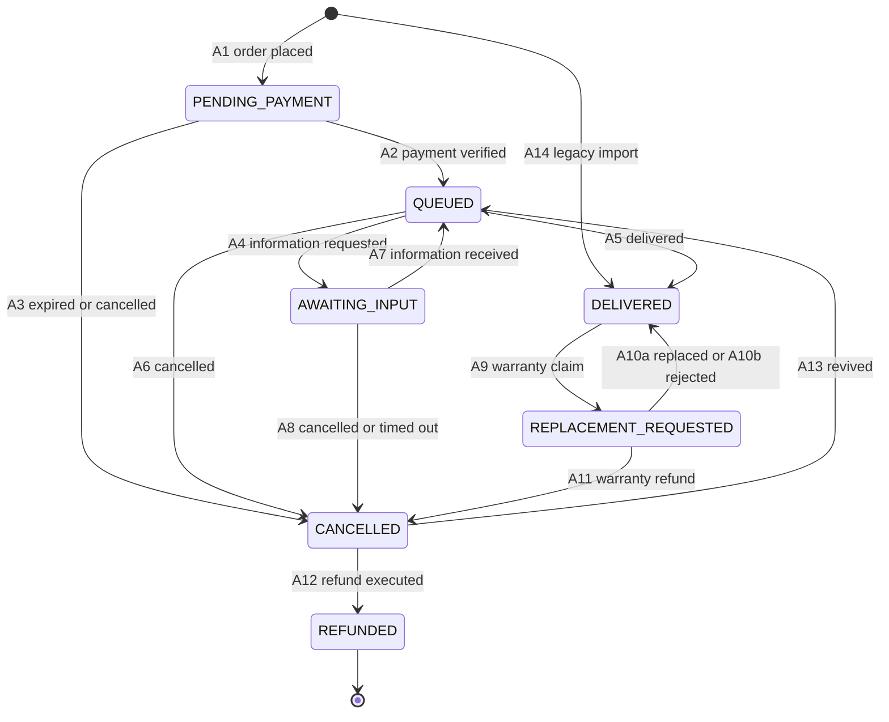

# Order lifecycle

How an order item moves from placement to delivery, which parts are built, and the rules that keep simultaneous requests safe. Status lives on each `OrderItem`, never on the order; an order's state is read from its items ([ADR-0003](decisions/0003-order-status-on-item-seven-states.md)).

- [Rules for every status change](#rules-for-every-status-change)
- [Statuses](#statuses)
- [Transitions](#transitions) and [every ordered pair](#every-ordered-pair)
- [Built: placement](#built-placement)
- [Built: cancellation and expiry](#built-cancellation-and-expiry)
- [Concurrency](#concurrency)
- [Payment](#payment)
- [History and notifications](#history-and-notifications)
- [Tests](#tests)

## Rules for every status change

- **Only services change a status.** Every change is a function in `apps/orders/services.py` or `apps/payments/services.py`. A status written anywhere else is a defect.
- **Validate under the lock.** The service locks the rows it changes, re-reads their status under the lock and refuses a change the current status does not allow. The status a page or form showed is never trusted.
- **History in the same transaction.** Each change writes one `OrderItemEvent` per item in the transaction that makes it. The history is append-only, and a database trigger refuses edits and deletions.
- **No self-transitions.** An annotation that leaves the status as it is, such as a moved deadline, writes a history row whose status before and after are the same.

## Statuses

| Status | Meaning | Built |
|---|---|---|
| `PENDING_PAYMENT` | Placed and waiting for payment | Yes |
| `QUEUED` | Paid and waiting for the operator | Yes, by manual confirmation |
| `AWAITING_INPUT` | The operator needs information from the customer; the delivery clock is paused | No |
| `DELIVERED` | The account details have been delivered | No |
| `REPLACEMENT_REQUESTED` | A warranty claim after delivery | No |
| `CANCELLED` | Ended without delivery. Final, unless money is owed back or the operator revives a paid item | From `PENDING_PAYMENT` |
| `REFUNDED` | Money returned. Final | No |

## Transitions

| ID | Change | Trigger | Actor | Built |
|---|---|---|---|---|
| A1 | new → `PENDING_PAYMENT` | Checkout places the order | customer | Yes |
| A2 | `PENDING_PAYMENT` → `QUEUED` | The operator confirms an exact matching payment | operator | Yes, manual only |
| A3 | `PENDING_PAYMENT` → `CANCELLED` | The unpaid deadline passes, or the customer or the operator cancels | system, customer, operator | Yes; the operator's path is a service call, with no panel action yet |
| A4 | `QUEUED` → `AWAITING_INPUT` | The operator asks the customer for information | operator | No |
| A5 | `QUEUED` → `DELIVERED` | The operator delivers | operator | No |
| A6 | `QUEUED` → `CANCELLED` | An approved cancellation or a supply failure; a refund is recorded | operator | No |
| A7 | `AWAITING_INPUT` → `QUEUED` | The customer supplies the information | customer, operator | No |
| A8 | `AWAITING_INPUT` → `CANCELLED` | The operator cancels, or the input reminders run out at 21 days | operator, system | No |
| A9 | `DELIVERED` → `REPLACEMENT_REQUESTED` | A warranty claim | customer, operator | No |
| A10a | `REPLACEMENT_REQUESTED` → `DELIVERED` | A replacement is delivered | operator | No |
| A10b | `REPLACEMENT_REQUESTED` → `DELIVERED` | The claim is rejected, with a note | operator | No |
| A11 | `REPLACEMENT_REQUESTED` → `CANCELLED` | No replacement is possible; a warranty refund | operator | No |
| A12 | `CANCELLED` → `REFUNDED` | The refund is executed | operator | No |
| A13 | `CANCELLED` → `QUEUED` | Revival: a payment verified late, or a mistaken cancellation | operator | No |
| A14 | new → `DELIVERED` | Importing a subscription sold before launch (`legacy` channel only) | system | No |

### Every ordered pair

Twelve changes between statuses are allowed and 37 are forbidden, each for a reason. Rows are the status before, columns the status after: `PP` `PENDING_PAYMENT`, `Q` `QUEUED`, `AI` `AWAITING_INPUT`, `DEL` `DELIVERED`, `RR` `REPLACEMENT_REQUESTED`, `CAN` `CANCELLED`, `REF` `REFUNDED`.

| from \ to | PP | Q | AI | DEL | RR | CAN | REF |
|---|---|---|---|---|---|---|---|
| new | **A1** | unpaid | unpaid | **A14** | unpaid | unpaid | unpaid |
| PP | no-op | **A2** | unpaid | unpaid | unpaid | **A3** | via-cancelled |
| Q | paid | no-op | **A4** | **A5** | undelivered | **A6** | via-cancelled |
| AI | paid | **A7** | no-op | resume-first | undelivered | **A8** | via-cancelled |
| DEL | paid | via-replacement | via-replacement | no-op | **A9** | via-replacement | via-cancelled |
| RR | paid | loop-only | loop-only | **A10a, A10b** | no-op | **A11** | via-cancelled |
| CAN | revive-to-queued | **A13** | revive-to-queued | revive-first | undelivered | no-op | **A12** |
| REF | terminal | terminal | terminal | terminal | terminal | terminal | no-op |

| Reason | Meaning |
|---|---|
| unpaid | The payment has not been verified |
| paid | Money has been taken; an item never returns to before payment |
| undelivered | A replacement only makes sense after a delivery |
| resume-first | The item must return to `QUEUED`, restarting its deadline clock, before it is delivered |
| via-replacement | A problem after delivery goes through `REPLACEMENT_REQUESTED` only |
| via-cancelled | `REFUNDED` is reached only from `CANCELLED`, with an executed refund |
| loop-only | A claim resolves only to `DELIVERED` or `CANCELLED` |
| revive-to-queued | Besides a refund, the only way out of `CANCELLED` is revival, which lands on `QUEUED` because it requires a verified payment |
| revive-first | A cancelled item is revived before anything else happens to it |
| terminal | `REFUNDED` is final |
| no-op | A status never changes to itself |

Rules the designed transitions keep:

- **A delivery is never overwritten.** Re-delivery always passes through `REPLACEMENT_REQUESTED`, never `DELIVERED` → `DELIVERED`. Each delivery writes a new generation of delivery fields and keeps the old ones, so every set of account details is tied to the request that produced it.
- **A refund after delivery goes through a claim.** `DELIVERED` never goes straight to `CANCELLED`; the path is A9, then A11.
- **No refund status without a refund.** A12 requires an executed `Refund` row for the item or its order, checked by the service ([ADR-0019](decisions/0019-payment-gateway.md)).
- **Revival is guarded.** A13 requires a verified payment and no refund in progress for the item, and the delivery deadline restarts at the revival, not at the original payment.
- **A cancellation request is not a transition.** After payment, a customer's request marks the item and waits for the operator to approve it as A6 or A8.
- **Deadlines** are set when payment is verified, paused while the shop waits for the customer, and capped as [ADR-0009](decisions/0009-sla-clock-and-input-timeout-ladder.md) describes.

## Built: placement

`payments.checkout` locks the customer's account and cart and calls `orders.services.place_order`, which in one transaction:

1. Releases the customer's own overdue unpaid orders, then refuses a second live unpaid order; `UnpaidOrderExists` carries the existing one so the page can link to it.
2. Re-reads the account, the public products, the plans, their stock and the quantities, and prices every unit through `effective_price` at a single moment.
3. Validates the discount code under its row lock (window, capacity, the customer's earlier redemptions, minimum subtotal and eligible products), increments its use count and writes a `DiscountRedemption`.
4. Freezes the purchase: product, plan, price, cost, the input declaration, the discount and the published terms. Customer input is encrypted.
5. Decrements finite stock, marking each unit that did so, and writes one item and one history row per unit.
6. Refuses an order whose total is zero or whose amounts do not fit their columns.

The checkout coordinator deletes the cart's lines in the same transaction, so a failure anywhere leaves both the stock and the cart as they were. `orders.services.quote_order` runs the same computation without consuming anything, for the review page; `replay_checkout` returns the order a repeated submission already created.

## Built: cancellation and expiry

- **`cancel_unpaid_order(*, order_id, actor, note="")`** cancels a whole unpaid order for its owner, from the order page, or for an operator, who has no panel button for it yet; an operator acting for a customer must give a reason. It locks the order and its items, returns the stock that placing it took (only while the plan still counts stock), releases the discount redemption, and writes one history row per item. Repeating it changes nothing, and a paid item is refused.
- **`expire_unpaid_orders(*, limit=100)`** runs every minute on the worker. Each overdue order is released in its own transaction through the same cancellation code. A failure is logged with the order id and exception type only, and the order is retried after those not yet attempted, so one bad order cannot hold up the rest. A database failure stops the sweep without recording it as successful.
- **The deadline is fixed at placement**, 24 hours later, and nothing extends it. Viewing a page never cancels or expires an order; an overdue order shows its ended deadline until the worker releases it.

## Concurrency

- **One lock order for everything:** account, then cart, existing orders, payment if present, products, plans, discount codes and items, each group in primary-key order. Any new path that touches these rows, payment included, follows the same order, which is what rules out deadlocks between checkout, cancellation and the sweep.
- **Validate under the lock.** A stale page or a second tab never decides a transition: the second request finds the new status and changes nothing.
- **No gateway call inside an order transaction.** Once payment exists, the order is committed before the gateway is called, so a slow gateway cannot hold the order's locks.
- **Repeated submissions are harmless.** A repeated checkout returns the order it already created, and a second cancellation finds the order already cancelled.

## Payment

The built route is an operator's record of money received outside the gateway ([ADR-0019](decisions/0019-payment-gateway.md)). The order editor links to a CSRF-protected form for the received amount in whole toman and a bank reference. Active staff need `payments.add_payment`, `orders.change_order` and `orders.change_orderitem`. The service re-reads the stored operator and permissions; customer forms cannot confirm payment.

`record_manual_payment(*, order_id, actor, amount, bank_ref)` locks the buyer and the order, then compares the entered amount with the order's saved total; a mismatch or a blank reference writes nothing. It then creates the manual `Payment` and calls `confirm_payment(*, payment_id, actor)`, which locks and re-reads that row. One transaction verifies the payment, sets each item's `paid_at` and moves every item to `QUEUED`, with an operator history row per item. Stock and discount claims are not taken again.

An identical retry returns the original payment, including after the old unpaid deadline. A changed reference is refused; the amount must still match. The database separately enforces at most one verified payment per order. An event-write failure rolls everything back. Cancellation and expiry take the same buyer and order locks, so either the confirmation wins or the cancellation does, never both.

A new confirmation and the payment action share `orders.services.can_pay_order`: an expired/cancelled order, non-pending item, missing required input/receipt, unknown purchased delivery hours, or Telegram-arranged details refuse new payment. An existing created/initiated/verified payment also blocks a new payment; identical verified confirmation remains a harmless replay. Input requirements and delivery hours come from the purchase snapshot, not later catalogue edits. The customer sees «در صف انجام» without the bank reference; the panel shows the reference only to staff with `payments.view_payment`.

Payment, each item's `paid_at`, `due_at`, `QUEUED` state and history commit together. `orders.clock.delivery_deadline` starts at the later of payment and required-detail receipt, or payment alone when no details are required. Missing required details mean no deadline; the initial wait is never also added as a pause. Purchased hours are elapsed hours. A deadline outside the daily Tehran support window, **10:00 inclusive to 22:00 exclusive**, moves forward to the next opening, then is capped at start plus 48 hours. The cap wins even outside support hours: payment Thursday at 23:00 with 48 purchased hours is due Saturday at 23:00. Telegram handoff, later pause/resume and refunds are not built.

The gateway request, callback verification and the lost-callback inquiry are not built. A future gateway must verify amounts server-to-server and use the same confirmation path; browser return parameters cannot prove payment. An inquiry failure must not be treated as unpaid money or abandon an attempt on a timer alone.

## History and notifications

`OrderItemEvent` is both the audit trail and the source of the customer's timeline: the order page shows statuses and times, and the panel adds who acted, never any secret value.

The purchase confirmation is found by polling committed orders, not by an event, under the key `purchase-confirmation:{order_pk}:email` (see [Email](architecture.md#email)). Paid transitions currently write audit history without sending messages. The remaining messages are designed as events emitted after a transition commits, each creating notification rows keyed `{occurrence}:{recipient}:{channel}` ([ADR-0010](decisions/0010-event-log-and-notification-outbox.md)):

| Event | After | Tells |
|---|---|---|
| `payment.verified` | A2 | The customer; the operator's new-order alert |
| `payment.failed` | a failed attempt | The customer, with a retry link |
| `item.awaiting_input` | A4 | The customer |
| `item.input_received` | A7 | The operator |
| `item.delivered`, `item.replaced` | A5, A10a | The customer, with the single-use delivery link |
| `item.replacement_requested` | A9 | The operator |
| `item.replacement_rejected` | A10b | The customer |
| `item.cancelled` | A3, A6, A8, A11 | The customer |
| `item.refunded` | A12 | The customer |
| `item.cancellation_requested` | a cancellation request | The operator |

No message carries a credential value or customer input ([ADR-0008](decisions/0008-content-free-messages-and-magic-link.md)).

## Tests

| Behaviour | Tests |
|---|---|
| Placement, quotes, snapshots and the money invariant | `apps/orders/tests/test_orders.py`, `test_purchase_record.py`, `test_purchase_inputs.py` |
| Discount codes | `apps/orders/tests/test_discounts.py` |
| Cancellation, expiry and the sweep | `apps/orders/tests/test_lifecycle.py`, `test_tasks.py` |
| Lock order and races, including two buyers competing for the last unit or a single-use code | `apps/orders/tests/test_lifecycle_concurrency.py`, `apps/payments/tests/test_concurrency.py` |
| Manual payments, permissions, CSRF, privacy, races, migrations and browser flow | `apps/payments/tests/test_manual_payment*.py` |
| Checkout, replays and inline sign-in | `apps/payments/tests/test_checkout.py`, `test_views.py`, `test_signin_ux.py` |
| Customer pages, tracking and the invoice | `apps/orders/tests/test_customer_pages.py` |
| Staff reveal of customer input and its log | `apps/orders/tests/test_input_reveal.py` |
