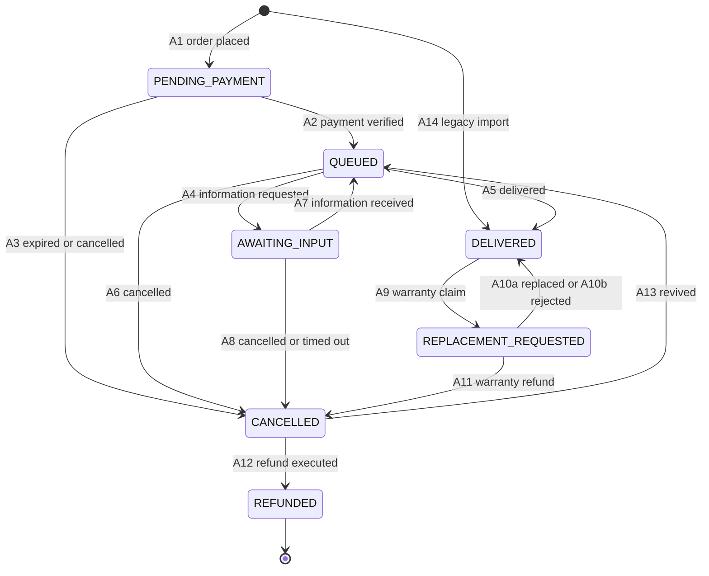

# Order lifecycle

How an order item moves from placement to delivery, which parts are built, and the rules that keep simultaneous requests safe. Status lives on each `OrderItem`, never on the order; an order's state is read from its items ([ADR-0003](decisions/0003-order-status-on-item-seven-states.md)).

- [Rules for every status change](#rules-for-every-status-change)
- [Statuses](#statuses)
- [Transitions](#transitions) and [every ordered pair](#every-ordered-pair)
- [Built: placement](#built-placement)
- [Built: cancellation and expiry](#built-cancellation-and-expiry)
- [Concurrency](#concurrency)
- [Payment](#payment)
- [Input requests and pauses](#input-requests-and-pauses)
- [Operator queue](#operator-queue)
- [Delivery](#delivery)
- [Paid cancellation and refunds](#paid-cancellation-and-refunds)
- [History and notifications](#history-and-notifications)
- [Tests](#tests)

## Rules for every status change

- **Only services change a status.** Every change is a function in `apps/orders/services.py` or `apps/payments/services.py`. A status written anywhere else is a defect.
- **Validate under the lock.** The service locks the rows it changes, re-reads their status under the lock and refuses a change the current status does not allow. The status a page or form showed is never trusted.
- **History in the same transaction.** Each change writes one `OrderItemEvent` per item in the transaction that makes it. The history is append-only, and a database trigger refuses edits and deletions.
- **No self-transitions.** An annotation that leaves the status as it is, such as a moved deadline, writes a history row whose status before and after are the same.

## Statuses

| Status | Meaning | Built |
|---|---|---|
| `PENDING_PAYMENT` | Placed and waiting for payment | Yes |
| `QUEUED` | Paid and waiting for the operator | Yes, by manual confirmation |
| `AWAITING_INPUT` | Required details are missing; the clock has not started, or a running deadline is paused | Yes |
| `DELIVERED` | The account details have been delivered | Yes, by the operator |
| `REPLACEMENT_REQUESTED` | A warranty claim after delivery | Yes, opened by the operator |
| `CANCELLED` | Ended without delivery. Final, unless money is owed back or the operator revives a paid item | From `PENDING_PAYMENT`, and after payment by the operator ([paid cancellation](#paid-cancellation-and-refunds)) |
| `REFUNDED` | Money returned. Final | By recording a completed manual transfer |

## Transitions

| ID | Change | Trigger | Actor | Built |
|---|---|---|---|---|
| A1 | new → `PENDING_PAYMENT` | Checkout places the order | customer | Yes |
| A2 | `PENDING_PAYMENT` → `QUEUED` | The operator confirms an exact matching payment | operator | Yes, manual only |
| A3 | `PENDING_PAYMENT` → `CANCELLED` | The unpaid deadline passes, or the customer or the operator cancels | system, customer, operator | Yes; the operator's path is a service call, with no panel action yet |
| A4 | `QUEUED` → `AWAITING_INPUT` | The operator asks the customer for information | operator | Yes; also part of Telegram payment handoff |
| A5 | `QUEUED` → `DELIVERED` | The operator delivers | operator | Yes |
| A6 | `QUEUED` → `CANCELLED` | A supply failure; the refund it owes is recorded | operator | Yes |
| A7 | `AWAITING_INPUT` → `QUEUED` | The customer supplies the information | customer, operator | Yes; operator controls, owner-authorized services |
| A8 | `AWAITING_INPUT` → `CANCELLED` | A supply failure, or details still missing 21 Tehran calendar days after the request | operator | Yes, by hand; the reminders that would lead there are not built |
| A9 | `DELIVERED` → `REPLACEMENT_REQUESTED` | A warranty claim | customer, operator | Yes, the operator's |
| A10a | `REPLACEMENT_REQUESTED` → `DELIVERED` | A replacement is delivered | operator | Yes |
| A10b | `REPLACEMENT_REQUESTED` → `DELIVERED` | The claim is rejected, with a note | operator | Yes |
| A11 | `REPLACEMENT_REQUESTED` → `CANCELLED` | No replacement is possible for a claim inside the warranty; a warranty refund | operator | Yes |
| A12 | `CANCELLED` → `REFUNDED` | The refund is executed | operator | Yes, for a completed manual bank transfer |
| A13 | `CANCELLED` → `QUEUED` | Revival: a payment verified late, or a mistaken cancellation | operator | No |
| A14 | new → `DELIVERED` | Importing a subscription sold before launch (`legacy` channel only) | system | No |

### Every ordered pair

Twelve changes between statuses are allowed and 37 are forbidden, each for a reason. Rows are the status before, columns the status after: `PP` `PENDING_PAYMENT`, `Q` `QUEUED`, `AI` `AWAITING_INPUT`, `DEL` `DELIVERED`, `RR` `REPLACEMENT_REQUESTED`, `CAN` `CANCELLED`, `REF` `REFUNDED`.

| from \ to | PP | Q | AI | DEL | RR | CAN | REF |
|---|---|---|---|---|---|---|---|
| new | **A1** | unpaid | unpaid | **A14** | unpaid | unpaid | unpaid |
| PP | no-op | **A2** | unpaid | unpaid | unpaid | **A3** | via-cancelled |
| Q | paid | no-op | **A4** | **A5** | undelivered | **A6** | via-cancelled |
| AI | paid | **A7** | no-op | resume-first | undelivered | **A8** | via-cancelled |
| DEL | paid | via-replacement | via-replacement | no-op | **A9** | via-replacement | via-cancelled |
| RR | paid | loop-only | loop-only | **A10a, A10b** | no-op | **A11** | via-cancelled |
| CAN | revive-to-queued | **A13** | revive-to-queued | revive-first | undelivered | no-op | **A12** |
| REF | terminal | terminal | terminal | terminal | terminal | terminal | no-op |

| Reason | Meaning |
|---|---|
| unpaid | The payment has not been verified |
| paid | Money has been taken; an item never returns to before payment |
| undelivered | A replacement only makes sense after a delivery |
| resume-first | The item must return to `QUEUED`, restarting its deadline clock, before it is delivered |
| via-replacement | A problem after delivery goes through `REPLACEMENT_REQUESTED` only |
| via-cancelled | `REFUNDED` is reached only from `CANCELLED`, with an executed refund |
| loop-only | A claim resolves only to `DELIVERED` or `CANCELLED` |
| revive-to-queued | Besides a refund, the only way out of `CANCELLED` is revival, which lands on `QUEUED` because it requires a verified payment |
| revive-first | A cancelled item is revived before anything else happens to it |
| terminal | `REFUNDED` is final |
| no-op | A status never changes to itself |

Rules the designed transitions keep:

- **A delivery is never overwritten.** Re-delivery always passes through `REPLACEMENT_REQUESTED`, never `DELIVERED` → `DELIVERED`. Each delivery writes a new generation of delivery fields and keeps the old ones, so every set of account details is tied to the request that produced it.
- **A refund after delivery goes through a claim.** `DELIVERED` never goes straight to `CANCELLED`; the path is A9, then A11.
- **No refund status without a refund.** A12 requires an executed `Refund` row for the item or its order, checked by the service ([ADR-0019](decisions/0019-payment-gateway.md)).
- **Revival is guarded.** A13 requires a verified payment and no refund in progress for the item, and the delivery deadline restarts at the revival, not at the original payment.
- **A cancellation request is not a transition.** After payment, a customer's request marks the item and waits for the operator to approve it as A6 or A8.
- **Deadlines** are set when payment is verified, paused while the shop waits for the customer, and capped as [ADR-0009](decisions/0009-sla-clock-and-input-timeout-ladder.md) describes.

## Built: placement

`payments.checkout` locks the customer's account and cart and calls `orders.services.place_order`, which in one transaction:

1. Releases the customer's own overdue unpaid orders, then refuses a second live unpaid order; `UnpaidOrderExists` carries the existing one so the page can link to it.
2. Re-reads the account, the public products, the plans, their stock and the quantities, and prices every unit through `effective_price` at a single moment.
3. Validates the discount code under its row lock (window, capacity, the customer's earlier redemptions, minimum subtotal and eligible products), increments its use count and writes a `DiscountRedemption`.
4. Freezes the purchase: product, plan, price, cost, the input declaration, the discount and the published terms. Customer input is encrypted.
5. Decrements finite stock, marking each unit that did so, and writes one item and one history row per unit.
6. Refuses an order whose total is zero or whose amounts do not fit their columns.

The checkout coordinator deletes the cart's lines in the same transaction, so a failure anywhere leaves both the stock and the cart as they were. `orders.services.quote_order` runs the same computation without consuming anything, for the review page; `replay_checkout` returns the order a repeated submission already created.

## Built: cancellation and expiry

- **`cancel_unpaid_order(*, order_id, actor, note="")`** cancels a whole unpaid order for its owner, from the order page, or for an operator, who has no panel button for it yet; an operator acting for a customer must give a reason. It locks the order and its items, returns the stock that placing it took (only while the plan still counts stock), releases the discount redemption, and writes one history row per item. Repeating it changes nothing, and a paid item is refused.
- **`expire_unpaid_orders(*, limit=100)`** runs every minute on the worker. Each overdue order is released in its own transaction through the same cancellation code. A failure is logged with the order id and exception type only, and the order is retried after those not yet attempted, so one bad order cannot hold up the rest. A database failure stops the sweep without recording it as successful.
- **The deadline is fixed at placement**, 24 hours later, and nothing extends it. Viewing a page never cancels or expires an order; an overdue order shows its ended deadline until the worker releases it.

## Concurrency

- **One lock order for everything:** account, then cart, existing orders, payment if present, products, plans, discount codes and items, each group in primary-key order. Any new path that touches these rows, payment included, follows the same order, which is what rules out deadlocks between checkout, cancellation and the sweep.
- **Validate under the lock.** A stale page or a second tab never decides a transition: the second request finds the new status and changes nothing.
- **No gateway call inside an order transaction.** Once payment exists, the order is committed before the gateway is called, so a slow gateway cannot hold the order's locks.
- **Repeated submissions are harmless.** A repeated checkout returns the order it already created, and a second cancellation finds the order already cancelled.

## Payment

The built route is an operator's record of money received outside the gateway ([ADR-0019](decisions/0019-payment-gateway.md)). The order editor links to a CSRF-protected form for the received amount in whole toman and a bank reference. Active staff need `payments.add_payment`, `orders.change_order` and `orders.change_orderitem`. The service re-reads the stored operator and permissions; customer forms cannot confirm payment.

`record_manual_payment(*, order_id, actor, amount, bank_ref)` locks the buyer and the order, then compares the entered amount with the order's saved total; a mismatch or a blank reference writes nothing. It then creates the manual `Payment` and calls `confirm_payment(*, payment_id, actor)`, which locks and re-reads that row. One transaction verifies the payment, sets each item's `paid_at` and moves every item to `QUEUED`, with an operator history row per item. Telegram-required items then move to `AWAITING_INPUT` with a second history row in that same transaction; ordinary items remain queued with deadlines. Stock and discount claims are not taken again.

An identical retry returns the original payment, including after the old unpaid deadline. A changed reference is refused; the amount must still match. The database separately enforces at most one verified payment per order. An event-write failure rolls everything back. Cancellation and expiry take the same buyer and order locks, so either the confirmation wins or the cancellation does, never both.

A new confirmation and the payment action share `orders.services.can_pay_order`. It refuses an expired or cancelled order, an item no longer in `PENDING_PAYMENT`, missing required checkout input, a missing non-Telegram receipt time, and unknown purchased delivery hours or input declarations. Telegram receipt is not a payment prerequisite. Another created, initiated or verified payment also blocks a new one; an identical repeat of a verified confirmation remains a harmless replay. Those expiry/open-attempt restrictions must be reconciled with money already moved before a gateway is added. Input requirements and delivery hours come from the purchase snapshot, not later catalogue edits. The customer sees each item's state without the bank reference; the panel shows the reference only to staff with `payments.view_payment`.

Payment, each item's `paid_at`, deadline, final state and history commit together. `orders.clock.delivery_deadline` starts at the later of payment and required-detail receipt, or payment alone when no details are required. `OrderItem.clock_requires_input` derives that requirement from checkout input **or** Telegram coordination. Missing first details mean no deadline and no pause marker. Purchased hours are elapsed hours. A deadline outside the daily Tehran support window, **10:00 inclusive to 22:00 exclusive**, moves forward to the next opening, then is capped at start plus 48 hours. The cap wins even outside support hours: payment Thursday at 23:00 with 48 purchased hours is due Saturday at 23:00.

The gateway request, callback verification and the lost-callback inquiry are not built. A future gateway must verify amounts server-to-server and use the same confirmation path; browser return parameters cannot prove payment. An inquiry failure must not be treated as unpaid money or abandon an attempt on a timer alone.

## Input requests and pauses

`request_input`, `receive_input` and `resume_input` take `order_id`, `item_id`, `actor` and `expected_event_id`. They re-read the active actor and lock buyer, order and item. Requests require staff with both order/item change permissions. Receipt and resume also permit the order's own customer through the services; no customer submission form is exposed yet. Admin POST controls only call these services. GET changes nothing.

Telegram items leave `input_received_at` null at checkout even when an email or username was collected. Handoff records `input_requested_at` and makes the request available on the owner's order page through the existing support destination; it does not send a message. First receipt computes the deadline once. A later request retains the deadline and sets `sla_paused_at`; resume adds exactly the elapsed pause, clears that marker and preserves the original first receipt. It neither snaps the shifted deadline nor reapplies the original cap. The database refuses a pause marker without a deadline.

The expected history event identifies the waiting episode. Immediate repeats return the completed result without another event or clock change; stale actions cannot affect a newer episode. Repeated requests keep the existing request time. That time anchors the 48-hour reminder, seven-day flag, 14-day warning and 21-calendar-day input timeout; receipt ends the episode and a distinct later request starts another. These automated steps remain unbuilt; the cancellation at 21 days is the operator's ([paid cancellation](#paid-cancellation-and-refunds)), and it must be demonstrated before affected paid orders are accepted. Holidays never stop this ladder ([ADR-0009](decisions/0009-sla-clock-and-input-timeout-ladder.md)).

## Operator queue

The existing order list opens on queued work, with unpaid and waiting-for-details tabs and an all-orders view. Each row is an order; a mixed order appears in each relevant tab, and tab counts count orders rather than items. Search by order number or customer email applies to the counts too. Pages contain at most 25 orders.

Unpaid orders sort by payment expiry; queued orders sort by their earliest item deadline, overdue first; waiting orders sort by their oldest information request; open warranty claims, in their own tab, sort by their oldest first delivery. A first wait shows the request time without a deadline. A paused item shows `due_at - sla_paused_at`, including time already overdue when paused. The displayed times are snapshots, with a check time and a refresh link on the list. Opening a page never writes a deadline.

Only permitted active staff can read the list, its search results or counts. Django's admin wrapper marks successful responses and login redirects private and no-store. Lists never select or render customer input. The order detail shares the time display and retains the existing payment, input-action and logged reveal paths and their permissions, and links each queued, delivered or claimed item to its delivery page.

## Delivery

A queued item's row on the order page links to its delivery page; staff need change permission on both Order and OrderItem. The page has three columns: the customer (email, the logged input reveal and the request-input control), the payment (paid time, prices and, with `payments.view_payment`, the bank reference) and the supply (purchase cost, the plan's supplier link and the product's `delivery_template`, word for word).

The operator writes up to six lines, each a title and a value, an optional note to the customer, the subscription's last day in the Persian calendar (prefilled from the plan's duration, empty for no end) and the actual cost (prefilled from the purchase cost). The preview shows the set exactly as it will be stored: the preview and the service read the form through the same `delivery_content`. Between preview and confirm the typed values travel only as hidden fields of the posted form, never in the session, a cache or a message.

`deliver_item(*, order_id, item_id, actor, expected_event_id, lines, note, expires_at, actual_cost)` re-reads the active staff account and locks buyer, order and item. It refuses a stale page, an item that is not `QUEUED`, a paused clock, an empty or half-written line, a past end date and a cost that is not whole toman. Then, in one transaction, it moves the item to `DELIVERED` (A5), sets `delivered_at`, `expires_at` and `actual_cost`, and writes the history row, the `Delivery` and its encrypted lines. A repeat of the same operator's confirmation from the same page, such as a double click or a second tab, is refused with a message that the item was already delivered, that the details in this form were not saved, and where the stored details are; it is never reported as success, because its own values were not stored. Another operator's late confirmation gets the stale-page refusal. Either way there is one delivery and one history row.

Only `reveal_delivery` decrypts a stored set. It requires view or change permission on both Order and OrderItem and, inside a durable transaction, writes a `CredentialAccessLog` row with target `delivery` before it loads and returns the latest set. No list, inline, history or other panel page loads a value. The delivery page and every reveal page bypass compression and caching (`Content-Encoding: identity`, no-store). The delivery page uses a same-origin referrer policy, because under `no-referrer` the browser sends `Origin: null` and the CSRF check refuses the post, and both of its posts hide their fields from error reports.

A queued item's delivery page also records a supply delay: `delay_supply` adds 1 to 72 hours, with a required note, to an unpaused queued item's deadline and moves the result into the 10:00–22:00 support window like every deadline. The status does not change; the history row's status before and after are both `QUEUED`, and its note carries the new deadline.

### Warranty claims

A delivered item's row links to the same page, which then opens a claim: `open_claim` (A9) needs a note, which stays in the history, so the page asks for no password in it. The page of an open claim shows that note and offers two exits. `replace_delivery` (A10a) takes the delivery form with an extra supply cost in place of the actual cost; it writes a new set, keeps every earlier one, adds the extra cost to `actual_cost`, sets `expires_at` and leaves `delivered_at` at the first delivery. `reject_claim` (A10b) needs a note and stores no set. Only `deliver_item` serves a `QUEUED` item and only `replace_delivery` serves a claim, so `DELIVERED` → `DELIVERED` has no entry point. Each service refuses a stale page and names a repeated submission from the same page, as delivery does; `replace_delivery` and `reject_claim` tell each other apart by whether the latest history row has a set. A customer's own claim and the claim and replacement messages are not built; a claim that cannot be replaced ends in a [paid cancellation](#paid-cancellation-and-refunds).

A product whose warranty runs to the end of the period cannot be delivered or replaced without the subscription's last day, because its retention deadline depends on it.

### Retention

Every day at 03:25 UTC (06:55 in Tehran) `delete_expired_details` deletes what ADR-0007 keeps no longer. An item's delivered sets, their notes and its customer input are deleted together at `retention_deadline`: the later of `expires_at` and the warranty's end (the delivery day for no warranty, seven days after delivery for a seven-day warranty, `expires_at` for a full-period one), plus 30 days, counted in Tehran calendar days; a set delivered later, such as a replacement after the warranty, is kept at least 30 days after its own delivery. A cancelled item that was never delivered loses its customer input 30 days after its cancellation. The job selects only items that still hold details, whatever their status, so a missed day is caught up the next and a rerun deletes nothing; an open claim waits until it closes. Each deletion writes a system history row with the same status before and after. Afterwards the reveal says the details were deleted under the retention rule.

The customer's masked view, the single-use delivery link and the delivery message are not built ([ADR-0008](decisions/0008-content-free-messages-and-magic-link.md)). Real deliveries wait for the offline key escrow and a restore that decrypts ([ADR-0007](decisions/0007-credential-encryption-key-escrow-retention.md)).

## Paid cancellation and refunds

The shop refunds only what it cannot supply, so a paid item is cancelled for one of three reasons, each from its own statuses; nothing voluntary is accepted after payment.

| Reason | From | Owes |
|---|---|---|
| `supply_failure` | `QUEUED` (A6) or `AWAITING_INPUT` (A8) | The item's paid amount |
| `input_timeout` | `AWAITING_INPUT` (A8), from the 21st Tehran calendar day after `input_requested_at` | The item's paid amount; the unit returns to stock |
| `warranty_refund` | `REPLACEMENT_REQUESTED` (A11), for a claim opened inside the warranty | The unused days |

An item's paid amount is `price_snapshot − discount_share`. A claim is inside the warranty when it was opened within seven days of delivery for a seven-day warranty, or on or before `expires_at` for one that runs to the end of the period. An item with no warranty, or whose subscription ended before the claim, is not refunded; the operator rejects the claim instead. The unused days run from the claim's opening through `expires_at`, out of the days from delivery through `expires_at`, in Tehran calendar days, and the days a claim stays open are not charged: delivered on 22 November with 21 December as the last day, a claim opened on 2 December used 10 of 30 days, so an item that cost 96,667 toman gets back 96,667 × 20 ÷ 30, rounded half up to 64,445. Without an `expires_at`, the whole paid amount. An item whose paid amount is zero, because a fixed code covered all of it, is cancelled with nothing owed.

The item's delivery page offers the reasons its status allows that day, each with the amount it would owe, read through the same `refund_amount` the service uses; a waiting item's row on the order page links to it. Staff need `payments.add_refund` besides the order and item change permissions. `cancel_paid_item(*, order_id, item_id, actor, expected_event_id, reason, note)` locks the buyer, the order, the verified payment, the item's product and plan, the discount code and the item, in the shared lock order, then in one transaction cancels the item with its reason and a history row carrying the note, creates the owed `Refund`, returns the unit for `input_timeout` and releases the discount use when it applies. A stale page is refused, and the same operator's repeat is named and changes nothing.

**The discount use** is held from placement, so two buyers cannot spend a single-use code at once. It comes back to the customer when every item the code covered (a share above zero) has ended without ever being delivered, and stays spent once any of them was delivered: a warranty refund never returns it, and an item the code did not cover never moves it.

The order page lists each item's refund and offers a form to record a completed manual bank transfer. It moves no money itself. The operator selects an explicit set of owed refunds on that order and enters the exact total sent, card or Sheba destination kind and last four digits, bank reference and Tehran bank date/time. The date is Jalali; the clock includes seconds and defaults to now. A future time, or one before any selected refund became owed at second precision, is refused. No full destination number is collected.

`payments.services.execute_refunds(*, order_id, refund_ids, actor, amount, destination_kind, destination_last4, bank_ref, executed_at)` requires an active staff account with refund-change, order-change and item-change permissions. It locks the buyer, order, verified payment, selected items and refunds, then rereads their state. The amount must be a positive whole-toman Decimal matching the selected frozen amounts exactly. Each refund becomes executed and `orders.services.mark_item_refunded` writes A12 with its history event in the same transaction. Bank time stays on the refund; the event records actual entry time. Empty, foreign, malformed, repeated or overlapping selections change nothing. Executed records cannot be corrected through this form, and a repeated submission explains that nothing new was recorded. The database guards in the [data model](data-model.md#payments) provide independent backstops.

The panel's daily reconciliation uses Tehran midnight inclusive through the next midnight exclusive. It separately totals payments confirmed, refunds newly owed and refunds sent, with one row per item refund. A refund owed yesterday and sent today belongs to each relevant day's activity; when both happen on one day the row appears once with both labels. Backdated bank entries update that bank day's report. Several item refunds in one transfer contribute their individual amounts, not a repeated transfer total.

References on other orders are compared across verified payments and executed refunds on every date, normalizing Persian/Arabic digits and removing whitespace without changing stored spelling, case or punctuation. Matches appear on the report and as warnings after a payment or refund save; they never refuse a valid write and are not retry identifiers. Bank facts are staff-only, absent from customer pages, invoices, tracking, history notes and error reports. Recording a transfer queues the content-free customer refund email after commit; gateway refunds are separate.

## Support ownership matching

The customer sends the order number and the private support identifier from their signed-in order detail. The identifier has twelve random uppercase letters and digits, excluding `0`, `O`, `1`, `I` and `L`, displayed in groups of four with a copy button. It stays valid until the owner explicitly replaces it. Replacement requires an owner-authorized POST and rejects confirmation of an identifier that has already changed.

The operator finds the authoritative order by its number in the existing panel, then submits the supplied identifier to a private comparison form. The server checks order-view permission before lookup and again for that object. Comparison accepts grouped or ungrouped text, hyphens and either letter case, and returns only match or mismatch. An invoice image does not prove ownership or payment. A match grants no permission to reveal input, record payment or change an item's state, and creates no reusable verification session.

The identifier is encrypted at rest in a separate one-to-one record and excluded from invoices, exported images, public tracking, lists, emails and error reports. It is never placed in a URL. Existing order queries, audit history and saved conditions do not need its encryption key. When that key cannot be read, the owner page marks the identifier unavailable and hides copy/replacement controls; operator comparison returns unavailable rather than mismatch. The owner page bypasses response compression and caching; its same-origin referrer policy permits protected form submissions while withholding its URL from external destinations. Existing encrypted-field rotation and restore checks include it.

## History and notifications

`OrderItemEvent` is both the audit trail and the source of the customer's timeline: the order page and the tracking page show statuses and times, leaving out rows whose status did not change (a moved deadline, a retention deletion), and the panel shows every row and who acted, never any secret value.

The purchase confirmation is found by polling committed orders, not by an event, under the key `purchase-confirmation:{order_pk}:email` (see [Email](architecture.md#email)). Explicit after-commit callbacks create the customer email updates below. Payment confirmation uses the payment's ID once for the whole order; item messages use their history occurrence. Outbox keys distinguish template, occurrence, customer and channel ([ADR-0010](decisions/0010-event-log-and-notification-outbox.md)). Operator request alerts remain planned with the customer request forms.

| Event | After | Tells |
|---|---|---|
| `payment.verified` (planned) | A2, operator alerts | The operator's new-order alert |
| `payment.failed` (planned) | A failed gateway attempt | The customer, with a retry link |
| `item.input_received` (planned) | A7 | The operator |
| `payment_confirmed` | Verified payment | The customer, once per payment |
| `input_requested` | A4 | The customer, with the order's input instructions |
| `delivery_completed` | A5, A10a | The customer, with the signed-in order link |
| `supply_delayed` | Supply-delay extension | The customer, with the frozen new deadline |
| `item.replacement_requested` (planned) | A customer's replacement request | The operator |
| `replacement_rejected` | A10b | The customer; operator notes are excluded |
| `item_cancelled` | A3, A6, A8, A11 | The customer; a refund is owed, not claimed sent |
| `item_refunded` | A12 | The customer after a transfer is recorded |
| `item.cancellation_requested` (planned; policy unresolved) | A future approved request flow | The operator |

No message carries a credential value or customer input ([ADR-0008](decisions/0008-content-free-messages-and-magic-link.md)). A customer who linked Telegram also receives each customer message there, as its subject and the order link. Single-use delivery links, timed input handling and gateway-failure notices remain planned separately.

## Tests

| Behaviour | Tests |
|---|---|
| Placement, quotes, snapshots and the money invariant | `apps/orders/tests/test_orders.py`, `test_purchase_record.py`, `test_purchase_inputs.py` |
| Discount codes | `apps/orders/tests/test_discounts.py` |
| Cancellation, expiry and the sweep | `apps/orders/tests/test_lifecycle.py`, `test_tasks.py` |
| Lock order and races, including two buyers competing for the last unit or a single-use code | `apps/orders/tests/test_lifecycle_concurrency.py`, `apps/payments/tests/test_concurrency.py` |
| Manual payments, permissions, CSRF, privacy, races, migrations and browser flow | `apps/payments/tests/test_manual_payment*.py` |
| Checkout, replays and inline sign-in | `apps/payments/tests/test_checkout.py`, `test_views.py`, `test_signin_ux.py` |
| Customer pages, tracking and the invoice | `apps/orders/tests/test_customer_pages.py` |
| Staff reveal of customer input and its log | `apps/orders/tests/test_input_reveal.py` |
| Delivery: storage, refusals, races, preview, reveal, privacy headers and error reports | `apps/orders/tests/test_delivery.py`, `test_delivery_browser.py` |
| Paid cancellation: reasons by status, warranty and 21-day boundaries, amounts, discount shares and their release, stock, repeats, permissions and the panel form | `apps/orders/tests/test_paid_cancellation.py`, `test_paid_cancellation_admin.py`, `test_paid_cancellation_browser.py` |
| The refund ledger's database guards | `apps/payments/tests/test_refund_guards.py` |
| Manual refund execution: selection, exact amount, facts, times, rollback, repeats and races | `apps/payments/tests/test_refund_execution.py`, `test_refund_concurrency.py` |
| Daily money activity, reference warnings, permissions, redaction and keyboard forms | `apps/payments/tests/test_reconciliation.py`, `test_refund_admin.py`, `test_refund_browser.py` |
